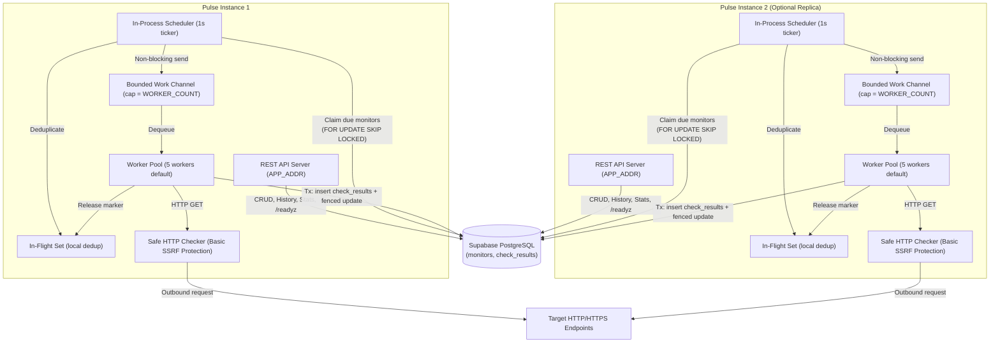

# Pulse

Pulse is a lightweight, demo-grade API uptime monitor written in Go and backed by hosted PostgreSQL (Supabase).

Pulse runs locally via Docker Compose (or directly on the host) and connects to Supabase using the IPv4-compatible shared Session Pooler on port 5432 with SSL required. Pulse is **designed to support horizontal scaling through multiple instances sharing PostgreSQL**: PostgreSQL coordinates monitor claims across independent instances using row-level locking (`SELECT ... FOR UPDATE SKIP LOCKED`), expiring leases, and claim-token fencing.

Each instance maintains its own bounded worker pool and in-memory work channel (sized to `WORKER_COUNT`). It periodically executes outbound HTTP/HTTPS health checks against registered endpoints, tracks monitor health state transitions, stores check history in PostgreSQL, and exposes a Bearer-authenticated REST API for managing monitors and querying availability and latency statistics.

> **Architecture & Scope**: All `/api/v1/` routes require service-to-service Bearer authentication via `PULSE_API_KEY` (minimum 32 characters). Health probes (`/healthz` and `/readyz`) remain public. Cloud deployment (AWS, ECS, EC2, autoscaling) is explicitly out of scope. While the PostgreSQL-backed claim and lease architecture is designed to support multiple instances sharing a database, outbound HTTP check execution is at-least-once rather than exactly-once, and horizontal autoscaling has not been deployed or load-tested.

---

## Architecture



### Architectural Principles

1. **PostgreSQL as Source of Truth & Coordination Tier**:
   - PostgreSQL stores all durable monitor state and historical check observations in exactly two tables: `monitors` and `check_results`. There is no persistent jobs table or external message broker.
   - Multi-instance coordination is handled natively in PostgreSQL via `ClaimDueMonitors` using `SELECT ... FOR UPDATE OF m SKIP LOCKED`. Claimed monitors receive a fresh UUID `claim_token` and an expiring lease (`claim_expires_at = db_clock.current_time + timeout_seconds + 30s`) without advancing `next_check_at`.
   - **Claim-Token Fencing**: Workers perform outbound HTTP requests outside database transactions, then commit results within a transaction that verifies `m.claim_token = $6 AND m.claim_expires_at > db_clock.current_time`. Stale workers whose leases expired cannot overwrite newer claims.

2. **In-Process Queue vs. Durable Storage**:
   - **PostgreSQL**: Stores durable monitor configuration, current health status, and check history.
   - **PostgreSQL Claims**: Coordinate work safely between independent application instances.
   - **In-Memory Channel**: Temporarily holds claimed work items dispatched to local worker goroutines within that process. The channel is bounded (capacity equals `WORKER_COUNT`), is not durable, and does not survive process restarts. If the channel is full, the claim is released immediately in PostgreSQL so it remains due on the next tick.

3. **Service-to-Service Authentication**:
   - All `/api/v1/` routes require `Authorization: Bearer <PULSE_API_KEY>` (minimum 32 characters, validated via constant-time comparison `crypto/subtle.ConstantTimeCompare`, never logged).
   - `/healthz` and `/readyz` remain public for container orchestration and uptime monitoring.

---

## Prerequisites

- **Go**: Version 1.27+ matching `go.mod` (for direct host runs and verification).
- **Docker**: Docker Desktop with WSL integration, or Docker Engine inside WSL.
- **Supabase Project**: A Supabase PostgreSQL database reachable via the IPv4-compatible shared Session Pooler on port 5432 with SSL required.

---

## First-Time Database Setup

Pulse does not use database migration frameworks (e.g., Goose, Flyway, Migrate) or automatic schema execution on application startup. The complete, idempotent schema is defined in a single file:

[`internal/db/schema.sql`](internal/db/schema.sql)

To initialize a fresh Supabase database:
1. Open the **Supabase Dashboard** and navigate to the **SQL Editor**.
2. Open [`internal/db/schema.sql`](internal/db/schema.sql) in this repository.
3. Copy the entire SQL content into a new query window in Supabase.
4. Execute the query once.
5. Verify in the **Table Editor** that the `monitors` and `check_results` tables and their associated indexes exist.

---

## Environment Setup

Pulse reads configuration from environment variables defined in [`internal/config/config.go`](internal/config/config.go). A template is available in [`.env.example`](.env.example).

The user's local `.env` file contains:

| Variable | Description |
|---|---|
| `DATABASE_URL` | Supabase IPv4 shared Session Pooler connection string (port 5432, `sslmode=require`) |
| `PULSE_API_KEY` | Generated service API key (minimum 32 characters) |
| `APP_ADDR` | Listen address (`0.0.0.0:8080` in container; defaults to `127.0.0.1:8080` on host) |
| `DB_MAX_CONNS` | Maximum database connections per instance (default `5`, range `1`–`20`) |
| `WORKER_COUNT` | Fixed worker pool size and work queue channel capacity (default `5`, range `1`–`64`) |
| `SCHEDULER_POLL_INTERVAL` | Poller tick duration for claiming due monitors (default `1s`) |

> [!NOTE]
> Go does not automatically load `.env` files when executed directly on the host. Docker Compose automatically handles `.env` variable interpolation for the container. Do not overwrite or delete the existing `.env` file.

---

## Running with Docker Compose

Start the Pulse application container:

```bash
docker compose up --build -d
```

This builds the minimal Alpine-based Pulse container and starts the application, connecting directly to your hosted Supabase PostgreSQL instance.

Check process logs:

```bash
docker compose logs -f app
```

Shut down the application:

```bash
docker compose down
```

> [!NOTE]
> Do not use `docker compose down -v` as routine shutdown. Pulse connects to hosted Supabase PostgreSQL; there is no local database volume to purge.

---

## Health Verification

Verify application liveness and Supabase database readiness using `curl`:

```bash
# Check process liveness
curl http://127.0.0.1:8080/healthz

# Check database readiness (verifies active connectivity to Supabase)
curl http://127.0.0.1:8080/readyz
```

Expected outputs:
- `/healthz`: `{"status":"ok"}`
- `/readyz`: `{"status":"ready"}` (returns HTTP 503 `{"status":"unavailable","error":"database unavailable"}` if Supabase is unreachable or uninitialized).

---

## Demonstration Walkthrough

Use the following cURL examples to demonstrate monitor management, health state transitions, history, and statistics.

Set your API key in your terminal session:

```bash
export PULSE_API_KEY="<your-configured-pulse-api-key>"
```

### 1. Verify Authentication Enforcement

Attempting to access protected `/api/v1/` routes without a valid Bearer token returns HTTP 401 Unauthorized:

```bash
curl -i http://127.0.0.1:8080/api/v1/monitors
```

Response:
```http
HTTP/1.1 401 Unauthorized
Www-Authenticate: Bearer
Content-Type: application/json

{"error":"unauthorized"}
```

### 2. Create a Monitor

Create an HTTP monitor targeting a reliable endpoint:

```bash
curl -s -X POST http://127.0.0.1:8080/api/v1/monitors \
  -H "Authorization: Bearer ${PULSE_API_KEY}" \
  -H "Content-Type: application/json" \
  -d '{
    "name": "Example Public API",
    "url": "https://example.com",
    "interval_seconds": 30,
    "timeout_seconds": 5
  }'
```

Response (`201 Created`):
```json
{
  "id": "11111111-2222-3333-4444-555555555555",
  "name": "Example Public API",
  "url": "https://example.com",
  "interval_seconds": 30,
  "timeout_seconds": 5,
  "current_status": "UNKNOWN",
  "consecutive_failures": 0,
  "last_checked_at": null,
  "last_success_at": null,
  "next_check_at": "2026-11-26T00:00:00Z",
  "created_at": "2026-11-26T00:00:00Z",
  "updated_at": "2026-11-26T00:00:00Z"
}
```

Notice that on creation:
- `current_status` starts as `"UNKNOWN"`.
- `consecutive_failures` is `0`.
- `next_check_at` equals `created_at` (due immediately on the next scheduler tick).

### 3. Observe Health State Transitions

Save the returned monitor UUID:

```bash
MONITOR_ID="11111111-2222-3333-4444-555555555555"
```

After 1–2 seconds, inspect the monitor state:

```bash
curl -s "http://127.0.0.1:8080/api/v1/monitors/${MONITOR_ID}" \
  -H "Authorization: Bearer ${PULSE_API_KEY}"
```

Once the worker executes the HTTP GET check and receives a `200 OK`:
- `current_status` transitions to `"UP"`.
- `last_checked_at` and `last_success_at` reflect the check timestamp.
- `next_check_at` is advanced to `clock_timestamp() + interval_seconds`.

*(If an endpoint returns `400–599` or fails network dial, `consecutive_failures` increments. A transition to `"DOWN"` occurs strictly upon reaching 3 consecutive failures).*

### 4. Inspect Check History

Retrieve recent check observation records:

```bash
curl -s "http://127.0.0.1:8080/api/v1/monitors/${MONITOR_ID}/checks?limit=10" \
  -H "Authorization: Bearer ${PULSE_API_KEY}"
```

Each record contains `id`, `monitor_id`, `checked_at`, `success`, `http_status`, `latency_ms`, and `error_message`.

### 5. Inspect Sliding-Window Statistics

Compute uptime availability and average latency over a window (e.g. 24 hours):

```bash
curl -s "http://127.0.0.1:8080/api/v1/monitors/${MONITOR_ID}/stats?hours=24" \
  -H "Authorization: Bearer ${PULSE_API_KEY}"
```

Response:
```json
{
  "monitor_id": "11111111-2222-3333-4444-555555555555",
  "window_hours": 24,
  "total_checks": 1,
  "successful_checks": 1,
  "failed_checks": 0,
  "availability": 100.0,
  "average_latency_ms": 42.5
}
```

> **Zero-Observation Rule**: When `total_checks == 0` within the window, `availability` and `average_latency_ms` return `null` (never `100%` or `0ms`).

### 6. Delete the Monitor

```bash
curl -i -X DELETE "http://127.0.0.1:8080/api/v1/monitors/${MONITOR_ID}" \
  -H "Authorization: Bearer ${PULSE_API_KEY}"
```

Returns `204 No Content`. Foreign key `ON DELETE CASCADE` removes all associated check results in `check_results`.

---

## Optional Multi-Instance Demonstration

To demonstrate multi-instance coordination, you can run two local Pulse processes simultaneously against the same Supabase database.

### How Coordination Works
- Both instances connect to the same Supabase database with the same `DATABASE_URL` and `PULSE_API_KEY`.
- Both schedulers tick every 1 second and run `ClaimDueMonitors`.
- PostgreSQL executes `SELECT ... FOR UPDATE SKIP LOCKED` so each due monitor is claimed by exactly one instance.
- Neither scheduler duplicates checks, and neither instance needs to know about the other (no gossip protocol, leader election, or message broker required).

### Setup (Manual Experiment)
1. Run Instance 1 via Docker Compose:
   ```bash
   docker compose up -d
   ```
   (Listens on `127.0.0.1:8080`).

2. Run Instance 2 directly on the host using a different port:
   ```bash
   export APP_ADDR="127.0.0.1:8081"
   export DB_MAX_CONNS="3"
   export WORKER_COUNT="5"
   export SCHEDULER_POLL_INTERVAL="1s"
   # Source DATABASE_URL and PULSE_API_KEY from .env
   go run ./cmd/pulse
   ```

3. Both instances will actively claim due monitors, execute checks, and persist results safely.

> [!NOTE]
> Keep `DB_MAX_CONNS` conservative (e.g. 3–5 per instance) so total application connections (`instance_count × DB_MAX_CONNS`) remain well within your Supabase pooler limit. This experiment demonstrates multi-instance correctness by design, not a production load or capacity test.

---

## Interview Claims & Limitations

### Supported by Design
- **Multi-Instance Coordination**: Designed to support horizontal scaling through multiple instances sharing PostgreSQL.
- **`SKIP LOCKED` Claiming**: Schedulers safely claim due monitors concurrently without race conditions or locks blocking other instances.
- **Lease Expiry Recovery**: If an instance crashes while holding a claim, the lease expires after `timeout_seconds + 30s`, allowing another instance to safely reclaim and check the monitor.
- **Fenced Persistence**: Database-enforced check verification (`m.claim_token = $6 AND m.claim_expires_at > db_clock.current_time`) ensures stale workers cannot overwrite newer claims.
- **Atomic Schedule Advancement**: Monitor health transitions, `next_check_at` calculation, and check result insertion commit together in a single PostgreSQL transaction.
- **Bounded In-Process Concurrency**: Fixed worker pool and bounded channel prevent resource exhaustion under load.

### Explicitly Not Demonstrated / Out of Scope
- **Cloud Deployment**: No AWS, ECS, EC2, Kubernetes, or cloud autoscaling infrastructure has been deployed or tested.
- **Automatic Instance Scaling**: Dynamic instance provisioning or autoscaling policies are not implemented.
- **Production Throughput / Load Testing**: Benchmarks and capacity limits have not been measured against high check volumes.
- **Formal SLA / SLO**: Availability metrics are straightforward historical ratios, not contractual SLAs.
- **Exactly-Once HTTP Execution**: Network requests are at-least-once. If a crash occurs after HTTP execution but before transaction commit, another instance will retry the check after lease expiration.

### Core Limitations
- **In-Memory Channel**: The work queue lives in memory; tasks in the channel do not survive process restarts.
- **Paused Checks**: Checks pause while application instances are stopped; missed intervals are never replayed upon restart.
- **PostgreSQL Dependency**: PostgreSQL is the single shared coordination and storage dependency.
- **Single-Tenant Authentication**: API authentication uses a single shared `PULSE_API_KEY`, without user accounts, roles, or multi-tenant isolation.
- **Basic SSRF Protections**: Custom dial-path IP validation and DNS checking are basic safeguards for demo purposes and do not replace production network egress firewalls.

---

## Verification Commands

Validate the codebase formatting, compilation, static analysis, and Docker Compose configuration:

```bash
# Verify formatting (expects clean/empty output)
gofmt -l .

# Build all packages
go build ./...

# Static analysis
go vet ./...

# Validate Docker Compose configuration
docker compose config --quiet

# Verify Docker container build
docker compose build
```
